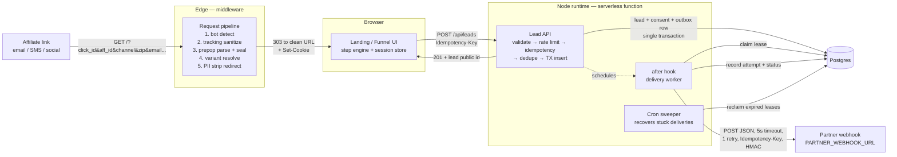
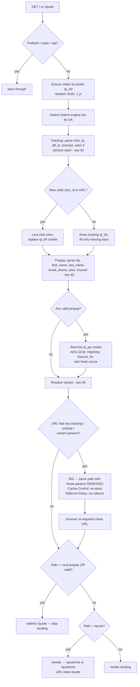
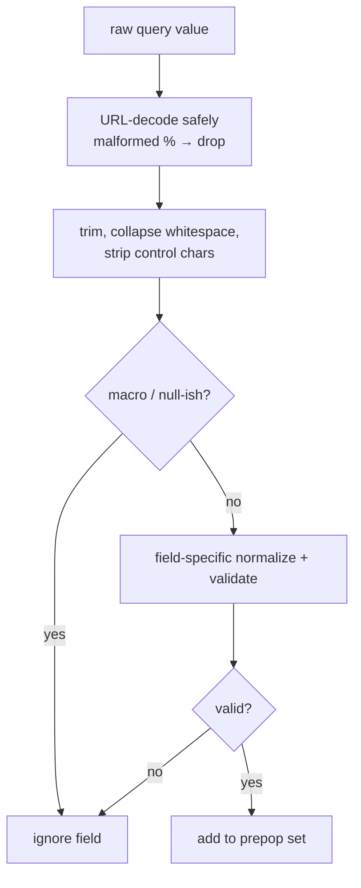
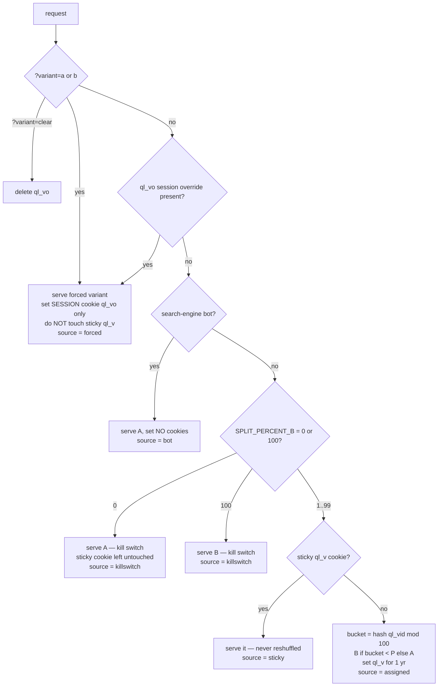
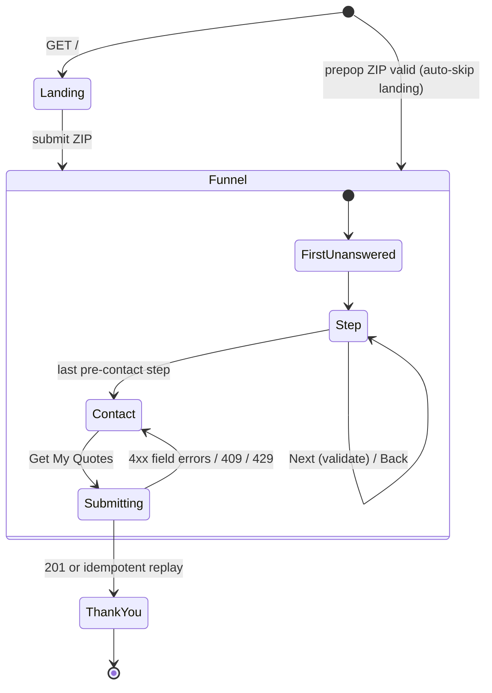
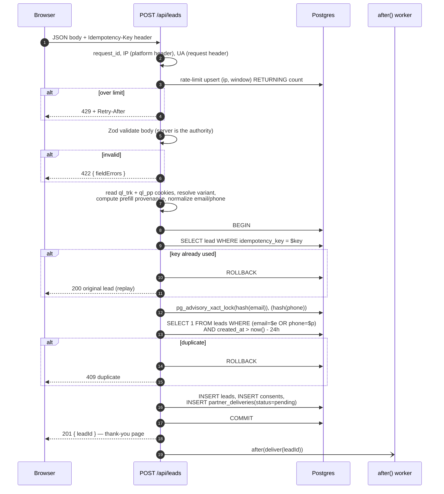
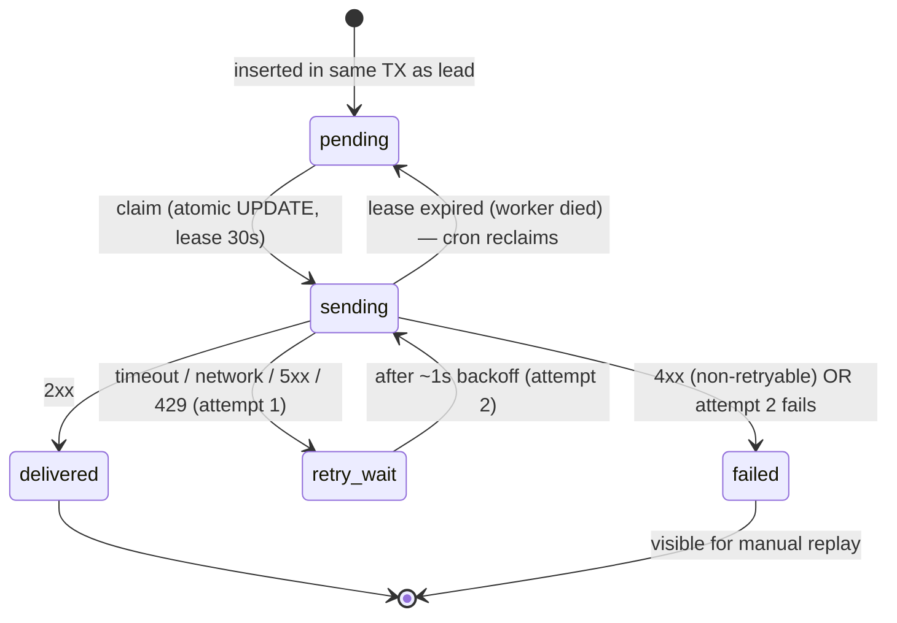
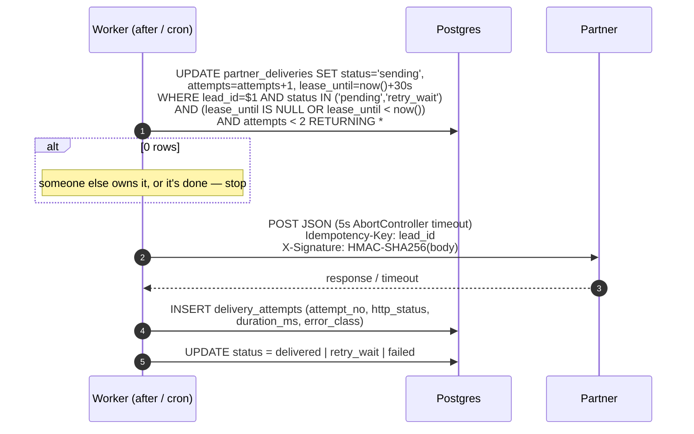
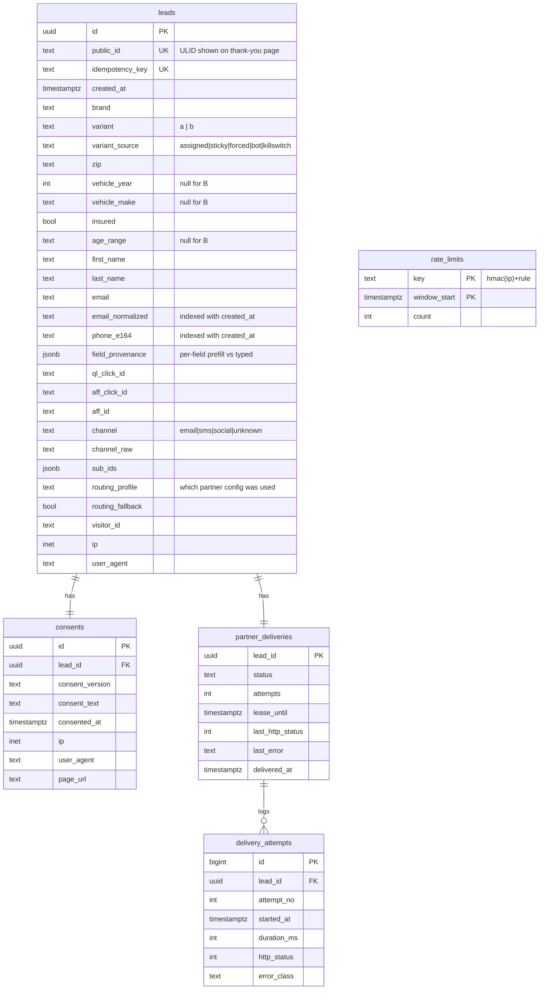

# QuoteLane — Architecture & Build Plan

> Status: **Implemented.** All §12 decisions were taken as recommended. Changes made during the build are listed in §15.

---

## 0. What we're building (one paragraph)

A lead-generation funnel. Affiliate traffic lands with tracking params (and sometimes prefilled personal data) in the URL. Edge middleware sanitizes and persists that context, assigns a sticky A/B variant, and strips PII from the address bar. The visitor completes a multi-step form (variant A = full, B = short). `POST /api/leads` validates everything server-side, enforces idempotency, de-duplication and rate limits, persists the lead + consent record in a single transaction, returns immediately, and delivers the lead to the partner **asynchronously** through a transactional outbox with lease-based exactly-once claiming, a timeout, and a single retry.

---

## 1. Tech stack & why

| Concern | Choice | Why (and what was rejected) |
|---|---|---|
| Framework | **Next.js (App Router, latest stable) + TypeScript strict** | Required. Middleware/proxy layer gives us an edge hook for tracking, prepop, split. |
| Database | **Postgres (serverless Postgres via the Vercel Marketplace free tier)** | SQLite **does not work on Vercel** — the function filesystem is ephemeral and per-instance, so leads would vanish and dedupe would break across instances. Postgres gives us real transactions, unique constraints, advisory locks and `SKIP LOCKED`. |
| ORM / migrations | **Drizzle ORM + drizzle-kit** | Typed SQL, versioned migration files committed to the repo, no runtime engine binary (cold-start friendly). Prisma rejected for cold-start size. |
| Validation | **Zod**, one schema module shared by client + server | Single source of truth; the client uses it for UX, the server re-runs it as the authority. |
| Async delivery | **`after()` (Next) + DB outbox + cron sweeper** | Thank-you page returns in ~100 ms regardless of partner latency. No external queue (spec forbids real third-party APIs, and it's one more moving part). |
| Rate limiting | **Postgres fixed-window counter** | In-memory limiters are useless on serverless (each instance has its own memory). Redis would be better at scale — noted in "before real traffic". |
| Logging | **Structured JSON logger with a PII redaction allow-list** | Logs carry `lead_id`, `request_id`, never raw query strings or contact fields. |
| Tests | **Vitest** (unit + API integration against a real Postgres) + **Playwright** (critical e2e paths) | Domain logic is pure and heavily unit-tested; DB behaviour (dedupe race, idempotency, outbox claim) is tested against real Postgres, not mocks. |

---

## 2. System overview



---

## 3. Request pipeline (middleware)

Runs on `GET` for `/` and `/quote` only. Skips `/api`, static assets, and Next prefetch requests (prefetches must never create assignments or cookies).



**Why redirect instead of `history.replaceState` on the client:** with client-side stripping the page has *already rendered* with PII in the URL — any analytics script, error reporter, or `` to a third party could have captured it in `location.href` or the `Referer`. With the 303 the PII-bearing URL never produces an HTML document at all; the browser only ever renders the clean URL.

**Defense in depth for PII:**
- Global `Referrer-Policy: strict-origin-when-cross-origin`, and `no-referrer` on the redirect response itself.
- Page `<title>` and metadata are static strings, never interpolated with user data.
- Logger never logs `request.url` / query strings; it logs `pathname` only.
- Funnel pages are `Cache-Control: private, no-store` (they render prefilled PII).
- Known residual: the platform's own edge request log records the *first* URL. Documented in README with the fix (log-drain scrubbing, or asking affiliates to pass prepop in the URL fragment).

---

## 4. Tracking params

| Param | Rule | On junk |
|---|---|---|
| `click_id` | `^[A-Za-z0-9._\-]{1,128}$`, not a macro | dropped (treated as missing) |
| `aff_id` | `^[A-Za-z0-9_\-]{1,64}$`, not a macro | dropped |
| `channel` | lower-cased; known set `email \| sms \| social`; otherwise `unknown` | raw value kept as `channel_raw` (sanitized) for reporting |
| `sub1..sub5` | same as click_id | dropped |

**Macro detection (shared with prepop):** after URL-decoding and trimming, a value is an *unreplaced macro* if it matches any of
`{...}`, `{{...}}`, `[...]`, `%%...%%`, `$...$`, `<...>`, or a null-ish literal (`null`, `undefined`, `none`, `n/a`, empty).
So `{sub5}`, `{aff_sub5}`, `[EMAIL]`, `%%email%%`, `{replace_it}` are all ignored.

**Persistence across the journey:** `ql_trk` cookie (HttpOnly, Secure, SameSite=Lax, 30 days). The **server reads it directly** at `POST /api/leads` — the browser never needs to forward it, so it survives refreshes, back/forward, the split rewrite and the prepop redirect automatically. Fallback: if cookies are blocked, the page embeds the same sanitized tracking and the client sends it in the body; the server re-sanitizes it.

**Two IDs (answers README Q-e):** we also mint our own `ql_click_id` (brand-prefixed, e.g. `ql_01J...` ULID) per tracked arrival. The affiliate's `click_id` is stored as `aff_click_id`. Never conflated.

---

## 5. Prepop (prefill)



| Field | Normalize | Valid when | Rejects (examples) |
|---|---|---|---|
| `zip` | strip spaces; accept `90210-1234` → `90210` | 5 digits, not `00000`, prefix not `000` | `1234`, `00000`, `ABCDE` |
| `first_name`, `last_name` | trim, collapse spaces, title-case if all-upper/lower | 1–50 chars, letters + `' - . space` | `{first}`, `12345` |
| `email` | trim, lower-case domain | Zod email + must have TLD, ≤254 | `notanemail`, `[EMAIL]` |
| `phone` | strip everything but digits; drop leading `1` if 11 digits | NANP: 10 digits, area code & exchange `[2-9]xx`, not all-same digit | `abc`, `123` |
| `year` | digits only | `1981 ≤ year ≤ currentYear + 1` | `1850`, `{sub5}` |
| `insured` | lower-case | `yes/y/true/1` → `true`, `no/n/false/0` → `false` | `maybe` |

`"+1 (555) 123-4567"` → `5551234567` ✅ · `sam%40example.com` → `sam@example.com` ✅ · `" 90210 "` → `90210` ✅

**Server-authoritative "was this prefilled?":** the sealed `ql_pp` cookie is read **again by the API on submit**. The server compares submitted values to the sealed prefilled values and stores, per field:

```json
{ "email": { "source": "prefill", "modified": false },
  "phone": { "source": "typed" },
  "zip":   { "source": "prefill", "modified": true } }
```

The browser cannot forge this — it's computed from an encrypted, HttpOnly cookie. Cookie is cleared after a successful submit.

**Skip rules (step engine):**
- Steps whose answer is prefilled + valid are **skipped on entry**; the visitor lands on the first unanswered step.
- If every pre-contact step is answered, they land straight on Contact.
- Back button walks through **all** steps, including skipped ones — prefilled values are shown editable, never locked.
- Prepop is applied once per nonce: refresh doesn't re-apply it over things the visitor edited; a *new* affiliate click (new nonce) starts a fresh journey.

---

## 6. A/B split



- `SPLIT_PERCENT_B` parsed defensively: non-numeric/out-of-range → `0` (fail safe to the control) + a warning log.
- Bucketing on a hash of the visitor id (not `Math.random`) means even if the `ql_v` cookie is lost but `ql_vid` survives, the visitor lands in the same bucket, and raising P only ever moves A→B, never B→A.
- **Q-f (kill switch):** at 0/100 everyone follows the setting — 0/100 means "broken" or "won", and serving a broken variant to sticky users is worse than a mid-funnel switch. Answers live in a shared store, so a switch mid-funnel loses nothing. The sticky cookie is *not* rewritten, so if the experiment is reopened the original cohorts are intact.
- **Q-g (testing on prod):** `?variant=b` sets a *session-only* cookie (dies with the browser), never the sticky one; `?variant=clear` drops it. Leads carry `variant_source = forced` so they're excluded from experiment reporting and flagged `test: true` to the partner.
- Variant A steps: `zip → year → make → insured → age → contact`. Variant B: `zip → insured → contact`. Same components, same store, same validators — only a step list differs.
- Variant + `variant_source` stored on the lead.

---

## 7. Front end



- **Funnel store:** one small client store persisted to `sessionStorage` (survives refresh, scoped to the tab, cleared on submit). Holds answers, current step, prepop nonce, idempotency key.
- **Step in URL:** `/quote?step=make` (no PII) so browser Back/Forward and refresh behave correctly.
- **Contact step:** first name, last name, email, phone + the consent text **verbatim** above the "Get My Quotes" button. Consent text lives in a versioned constant (`CONSENT_V1`) shared with the server.
- **Double-click safety:** button disables on submit, *and* every submit reuses the same `Idempotency-Key` (UUID created once per funnel session) — so even two concurrent requests resolve to one lead.
- Mobile-first, large tap targets, `inputmode`/`autocomplete` attributes, accessible errors (`aria-invalid`, `aria-describedby`), progress bar computed from step index.

---

## 8. Lead capture API — `POST /api/leads`



**Why advisory locks:** "check then insert" is a race — two different idempotency keys with the same email submitted at the same millisecond would both pass the check. Transaction-scoped advisory locks on the normalized email and phone serialize exactly those two submissions and nothing else; they release automatically at commit/rollback. A unique index can't express "within 24 h", which is why a plain constraint isn't enough.

**Idempotency:** `leads.idempotency_key` has a `UNIQUE` constraint as the final backstop; a unique-violation on insert is caught and turned into the replay response.

**Consent record (separate table, immutable):** `consent_version`, the exact `consent_text` the server holds for that version (the client only tells us *which* version it rendered; the server rejects unknown versions), `consented_at` (server clock), `ip` and `user_agent` (from the request, never the body), `page_url` (from body, must be same-origin, query string stripped).

**Rate limiting:** 5 submissions / 10 min / IP and 30 / hour / IP (two windows). IPs are hashed (HMAC with a secret) in the rate-limit table so it doesn't become a second PII store.

**Status codes:** `201` created · `200` idempotent replay · `409` duplicate · `422` validation · `429` rate limit · `415`/`400` bad content type / body · `500` generic (no internals leaked).

---

## 9. Partner delivery (outbox)





**"Never send twice" — what is actually guaranteed, honestly:**
1. **On our side, exactly one sender at a time:** the conditional `UPDATE ... RETURNING` is a compare-and-set. Double-clicks never create two leads (idempotency key), and two workers can never both claim one lead.
2. **Across the network, exactly-once is impossible in general** — if the partner receives attempt 1 but the response times out, we can't know. So every request carries `Idempotency-Key: <lead_id>` and `lead_id` in the body; a well-behaved partner dedupes on it. The README states this plainly rather than claiming magic.
3. Retry happens **at most once** (`attempts < 2` is in the claim predicate itself, not just in app code).

**Fast thank-you page:** the API commits and responds *before* any partner I/O; delivery runs in `after()` which the platform keeps alive after the response is sent. If the function dies mid-delivery, the lease expires and the cron sweeper (`/api/cron/deliveries`, protected by `CRON_SECRET`) reclaims it.

**Payload:** lead fields, `aff_click_id` (as `click_id`), `aff_id`, `channel`, `sub1-5`, our `lead_id` + `ql_click_id`, `brand`, `variant`, consent block (text version, timestamp, IP, UA, page URL), `test` flag for forced-variant leads. `PARTNER_WEBHOOK_URL` unset → status `skipped_unconfigured` (lead still saved; visible in reporting).

---

## 10. Data model



---

## 11. Code structure

```
quotelane/
├─ src/
│  ├─ middleware.ts                # thin: composes the pipeline from domain/
│  ├─ domain/                      # PURE, framework-free, 100% unit-tested
│  │  ├─ sanitize.ts               # decode, trim, macro detection
│  │  ├─ fields.ts                 # zod schemas + normalizers (shared client/server)
│  │  ├─ prepop.ts                 # query → validated prepop set
│  │  ├─ tracking.ts               # query → tracking set, last-click merge
│  │  ├─ variant.ts                # resolveVariant(input) → {variant, source, cookieOps}
│  │  ├─ steps.ts                  # step lists per variant, firstUnanswered, progress
│  │  ├─ consent.ts                # versioned consent text
│  │  └─ bots.ts
│  ├─ server/
│  │  ├─ db/ (schema.ts, client.ts, migrations/)
│  │  ├─ leads/ (lead.service.ts, lead.repo.ts, dedupe.ts, idempotency.ts)
│  │  ├─ delivery/ (outbox.ts, partner-client.ts, payload.ts, signer.ts)
│  │  ├─ rate-limit.ts
│  │  ├─ crypto/seal.ts            # AES-GCM cookie sealing
│  │  ├─ config.ts                 # env parsing with zod, fail-fast at boot
│  │  └─ logger.ts                 # JSON logs, PII redaction allow-list
│  ├─ app/
│  │  ├─ page.tsx                  # landing
│  │  ├─ quote/v/[variant]/page.tsx
│  │  ├─ thank-you/page.tsx
│  │  └─ api/ (leads/route.ts, cron/deliveries/route.ts, health/route.ts)
│  └─ components/funnel/ (FunnelShell, ProgressBar, steps/*, useFunnelStore)
├─ tests/ (unit/, integration/, e2e/)
├─ docs/ARCHITECTURE.md
├─ drizzle.config.ts · vercel.json (cron) · .env.example · README.md
```

Rule: `domain/` imports nothing from Next or the DB. Middleware and API are thin adapters over it — that's what makes the edge cases cheaply testable.

---

## 12. Decisions needing your sign-off

| # | Decision | My recommendation |
|---|---|---|
| D1 | Database | Serverless Postgres via Vercel Marketplace (free). SQLite can't persist on Vercel. You'll need to click "connect storage" in the Vercel dashboard — I can't do that for you. |
| D2 | Contact step | **One screen** with first/last name, email, phone + consent (matches "lands straight on *the* contact step"). Alternative: 3 separate screens. |
| D3 | Kill switch (Q-f) | At 0/100 **everyone follows**; sticky only applies in 1–99. |
| D4 | Forced variant (Q-g) | Session-only override cookie, `?variant=clear` to exit, leads tagged `test`. |
| D5 | Vehicle makes | The rules say "no real company names". Makes like Toyota are real companies — but a car form without them is odd. Option A: real makes (domain data, not partners). Option B: fictional makes. **I lean A**, but it's your call. |
| D6 | Duplicate response | `409` with a neutral "we already have your request" message. (Alternative: show thank-you silently to avoid revealing an email exists, at the cost of honesty to the user.) |
| D7 | Attribution | **Last-click wins** when a new valid `click_id` arrives; otherwise existing tracking is kept. |
| D8 | Brand separation (Q-i) | `BRAND_ID` env; brand stored per lead; our `ql_click_id` carries a brand prefix and goes in the partner's existing click/sub-id field, so both sides can split by prefix without new fields. |
| D9 | SMS without config (Q-h) | Lead accepted and delivered via the default routing profile; `channel=sms`, `routing_fallback=true` stored; warning logged. Never drop a consented lead over missing config. |
| D10 | Next.js version | Latest stable at build time (it may name the hook `proxy.ts` rather than `middleware.ts`; same concept). |

---

## 13. Build order (after approval)

1. Scaffold, strict TS, lint, env config with fail-fast validation, logger.
2. `domain/` modules + unit tests (sanitize, prepop, tracking, variant, steps) — the bulk of the edge cases.
3. DB schema + migrations, local Postgres.
4. Middleware pipeline.
5. Funnel UI (store, steps, progress, back, errors, consent) — both variants.
6. Lead API (rate limit, idempotency, dedupe with locks, transaction) + integration tests.
7. Outbox delivery worker + cron sweeper + tests with a fake slow/failing partner.
8. Playwright e2e: prepop → contact step, junk values, PII stripped from URL, sticky variant, double-click.
9. Deploy to Vercel, wire DB + env vars, verify end-to-end against webhook.site.
10. README (Parts 1–3).

## 14. What I'd change before real traffic (preview for the README)

Redis/edge KV rate limiting + bot/captcha challenge; a real queue with DLQ and replay UI; libphonenumber + a ZIP database; log-drain scrubbing of edge request logs; encryption at rest for contact fields and a retention/deletion policy; TCPA consent capture via a session-replay certificate vendor; alerting on delivery failure rate; per-partner circuit breaker; reporting views by channel/brand/variant.

## 15. Changes made during the build

| Plan | Built | Why |
|---|---|---|
| `middleware.ts` | `src/proxy.ts` | Next.js 16 renamed middleware to "proxy"; same role. |
| Body-level tracking fallback when cookies are blocked | Removed | A browser that blocks cookies never received the tracking cookie either, so the fallback had nothing to send. Tracking now comes only from our HttpOnly cookie. A server-side session is listed as the real fix. |
| Strict NANP phone rules | Exchange may start with 0/1 | The spec's own example `+1 (555) 123-4567` has exchange `123`; strict rules would reject the input we're told to accept. |
| Rate limit 5 / 10 min | 10 / 10 min + 30 / hour | 5 was too tight for a real person fixing validation errors on a shared IP (office, mobile carrier NAT). |
| `variant_source` values | added `mismatch` | Records when the rendered variant differs from what the server would serve at submit (e.g. kill switch flipped mid-funnel). |
