# QuoteLane: Codebase Flows

A visual map of the code, module by module: **which function runs, when, who calls it, and what it calls next.**

> **Viewing the diagrams:** they render automatically on GitHub. In VS Code, install the *Markdown Preview Mermaid Support* extension, then open the preview (`Ctrl+Shift+V`).

**How to read this doc**

| Section | Answers |
|---|---|
| [1. The big picture](#1-the-big-picture) | What are the layers and who depends on whom? |
| [2. One visitor, end to end](#2-one-visitor-end-to-end) | In what order does everything run for a single lead? |
| [3. `proxy.ts`](#3-proxyts--the-request-pipeline) | What happens before any page renders? |
| [4. Domain: input cleaning + prefill](#4-domain-input-cleaning--prefill) | How does a raw URL value become a trusted answer? |
| [5. Domain: tracking](#5-domain-tracking) | How do click_id / aff_id survive the journey? |
| [6. Domain: A/B variant](#6-domain-ab-variant) | How is A or B decided? |
| [7. Domain: step engine](#7-domain-step-engine) | Which step does the visitor see, and what's next? |
| [8. Pages (server components)](#8-pages-server-components) | What does each route render and read? |
| [9. Client funnel](#9-client-funnel-store--funnel--steps) | How do the store, `Funnel` and step components work together? |
| [10. `POST /api/leads`](#10-post-apileads--lead-capture) | What happens when "Get My Quotes" is clicked? |
| [11. Partner delivery](#11-partner-delivery-outbox) | How is the lead sent exactly once, with a timeout and a retry? |
| [12. Cron + health](#12-cron--health-routes) | How are stuck deliveries recovered? |
| [13. Shared server utilities](#13-shared-server-utilities) | config, logger, crypto, http, db |
| [14. Cookies](#14-cookie-lifecycle) | Who writes and who reads each cookie? |
| [15. Database](#15-database-tables-and-who-touches-them) | Which function touches which table? |
| [16. Where do I find…?](#16-where-do-i-find) | Quick lookup |

---

## 1. The big picture

Four layers. **Arrows point from caller to callee.** The rule that keeps it testable: `domain/` never imports from anything else.

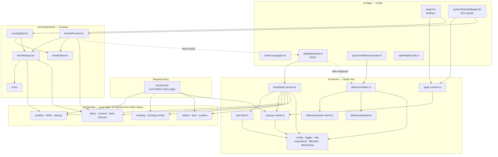

| Layer | Folder | Runs where | Job |
|---|---|---|---|
| Entry | `src/proxy.ts` | Server, before routing | Capture tracking + prefill, strip PII from the URL, pick the variant |
| Routes | `src/app/` | Server | Render pages, expose the API |
| UI | `src/components/` | Browser | Show the steps, hold answers, submit |
| Server | `src/server/` | Server (Node) | DB, crypto, delivery, logging |
| Domain | `src/domain/` | **Both** browser and server | Every rule and validator, as pure functions |

---

## 2. One visitor, end to end

The full timeline for one affiliate visitor, from click to partner delivery. Each box is a real function name.

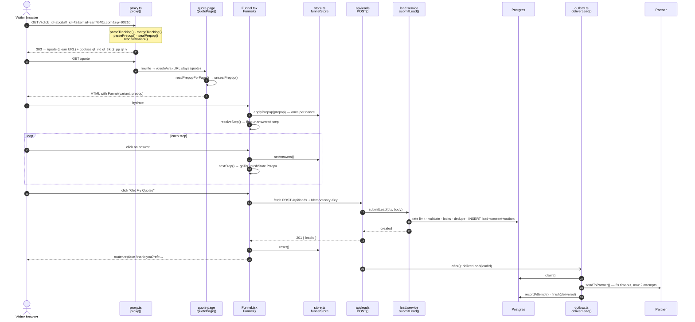

---

## 3. `proxy.ts` — the request pipeline

**When:** on every `GET` to `/`, `/quote` and `/quote/*` (see `config.matcher`), before the page renders.
**File:** [src/proxy.ts](../src/proxy.ts)

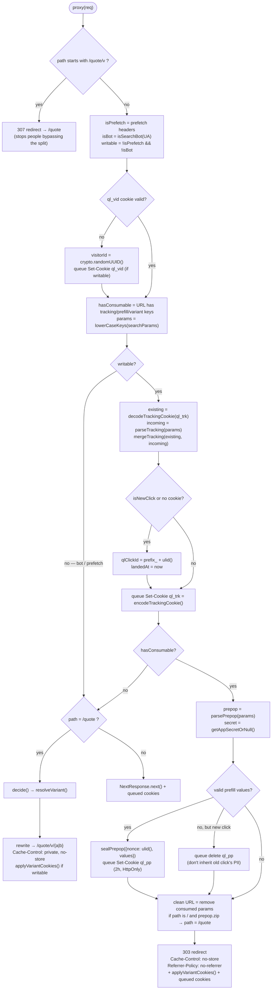

**Helper functions inside `proxy.ts`**

| Function | Called when | Does |
|---|---|---|
| `proxy(req)` | Every matched request | The pipeline above |
| `decide(req, visitorId, params, isBot)` | Rewrite for `/quote`, and from `applyVariantCookies` | Collects cookies + `?variant=` + split config → `resolveVariant()` |
| `applyVariantCookies(...)` | On the 303 redirect and the `/quote` rewrite | Writes `ql_vo` (session) / deletes it, writes `ql_v` (sticky). Never for bots. |
| `lowerCaseKeys(sp)` | Once per request | `Click_ID` and `EMAIL` match like `click_id` and `email` |

---

## 4. Domain: input cleaning + prefill

**When:** the proxy calls `parsePrepop()` on arrival; the server calls `revalidatePrepop()` every time it reads the prefill back from the cookie.
**Files:** [sanitize.ts](../src/domain/sanitize.ts) · [fields.ts](../src/domain/fields.ts) · [prepop.ts](../src/domain/prepop.ts)

### 4a. One raw value → trusted value

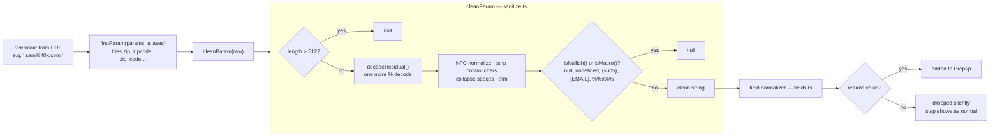

### 4b. Field normalizers (fields.ts)

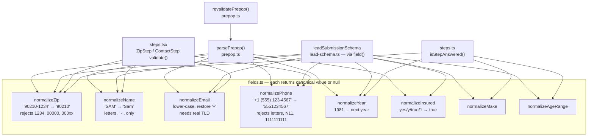

**Same validators, three callers.** The proxy uses them to decide what to prefill, the browser to show instant errors, and the API as the final authority. One rule, one place.

### 4c. Validation schema used by the API

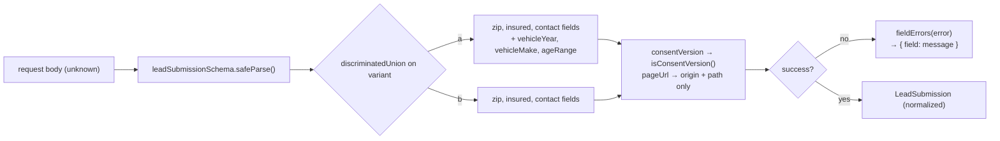

---

## 5. Domain: tracking

**When:** captured by the proxy on arrival; read back by `submitLead()` on submit.
**Files:** [tracking.ts](../src/domain/tracking.ts) · [tracking-cookie.ts](../src/domain/tracking-cookie.ts)

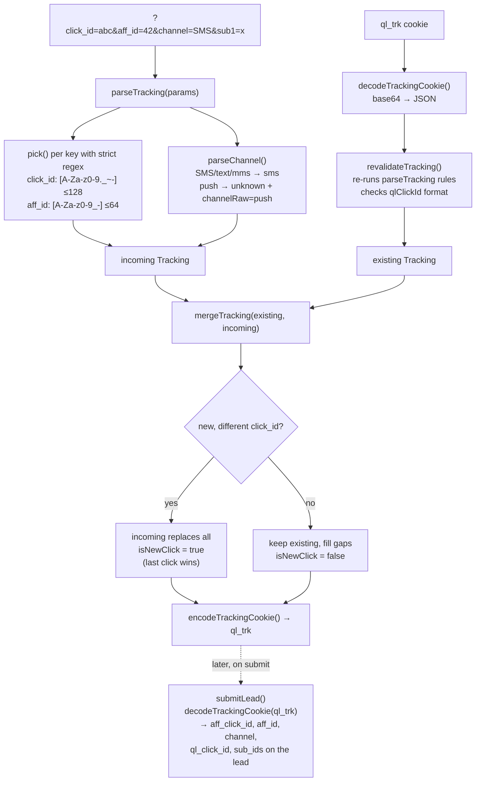

**Two click IDs:** `affClickId` is the affiliate's ID, stored as given. `qlClickId` is ours, minted in the proxy as `ql_<ULID>`. They are never mixed.

---

## 6. Domain: A/B variant

**When:** the proxy calls it to choose which form to render; `submitLead()` calls it again to record *why* the visitor saw that version.
**File:** [variant.ts](../src/domain/variant.ts)

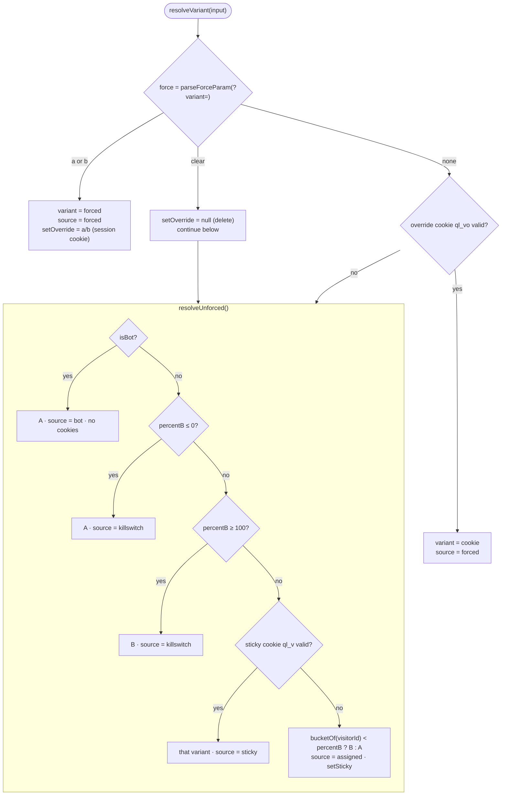

| Helper | Does |
|---|---|
| `parseSplitPercent(env)` | `"37"` → 37. Garbage, empty or out of range → **0** (safe default: everyone sees A) |
| `bucketOf(visitorId)` | FNV-1a hash → 0..99. Same visitor, same bucket, forever |
| `parseForceParam(raw)` | `a` / `b` / `clear` / null |
| `isVariant(v)` | Type guard, used to reject junk cookie values |

---

## 7. Domain: step engine

**When:** `Funnel.tsx` calls it on every render and every click.
**File:** [steps.ts](../src/domain/steps.ts)

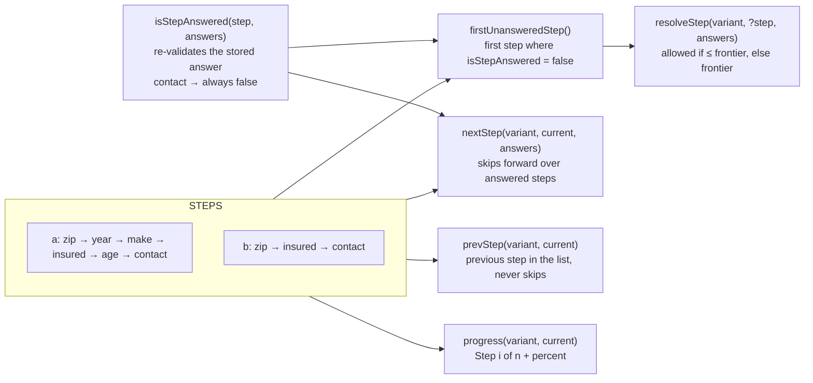

**Example, variant A with zip + insured prefilled:**

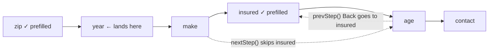

---

## 8. Pages (server components)

**When:** each time the route is requested (all are dynamic: they read cookies).

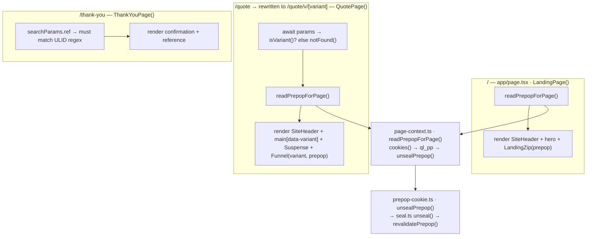

The layout ([layout.tsx](../src/app/layout.tsx)) only sets **static** metadata (title, viewport), so no visitor data can reach the tab title.

---

## 9. Client funnel (store + Funnel + steps)

### 9a. The store — [store.ts](../src/components/funnel/store.ts)

A tiny external store, persisted to `sessionStorage` under `ql_funnel_v1`.

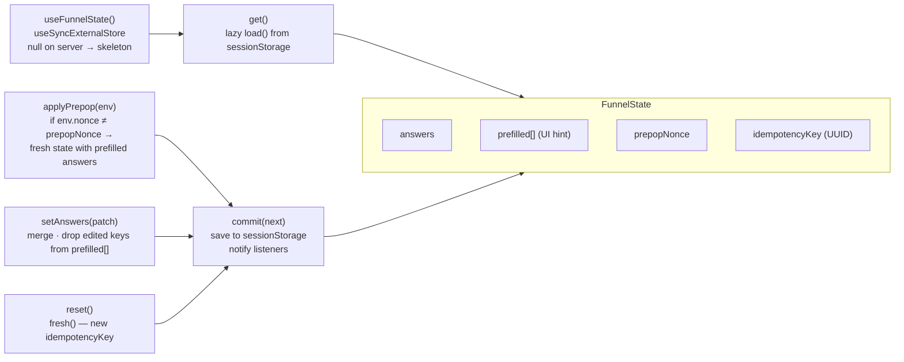

| Function | Called by | When |
|---|---|---|
| `applyPrepop` | `Funnel`, `LandingZip` (in `useLayoutEffect`) | First paint of a page that received a prefill |
| `setAnswers` | `answerAndAdvance`, `ContactStep` `onBlur`, `submit` | Each answer |
| `reset` | `Funnel.submit` | After `201`/`200` |
| `useFunnelState` | `Funnel`, `LandingZip` | Every render |

### 9b. `Funnel.tsx` — render + navigation

**File:** [Funnel.tsx](../src/components/funnel/Funnel.tsx)

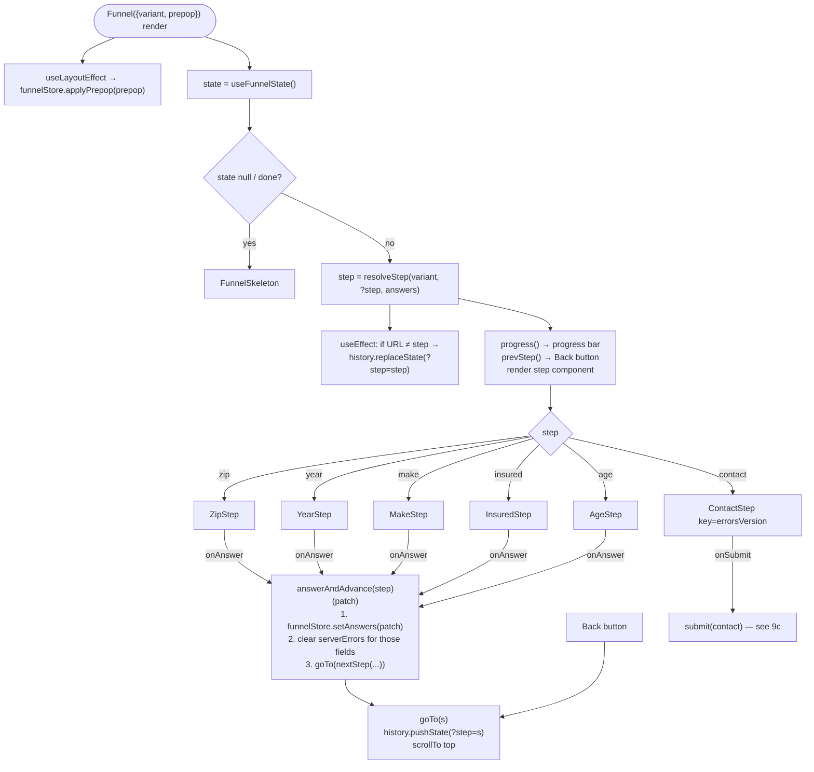

### 9c. Submitting — `Funnel.submit()`

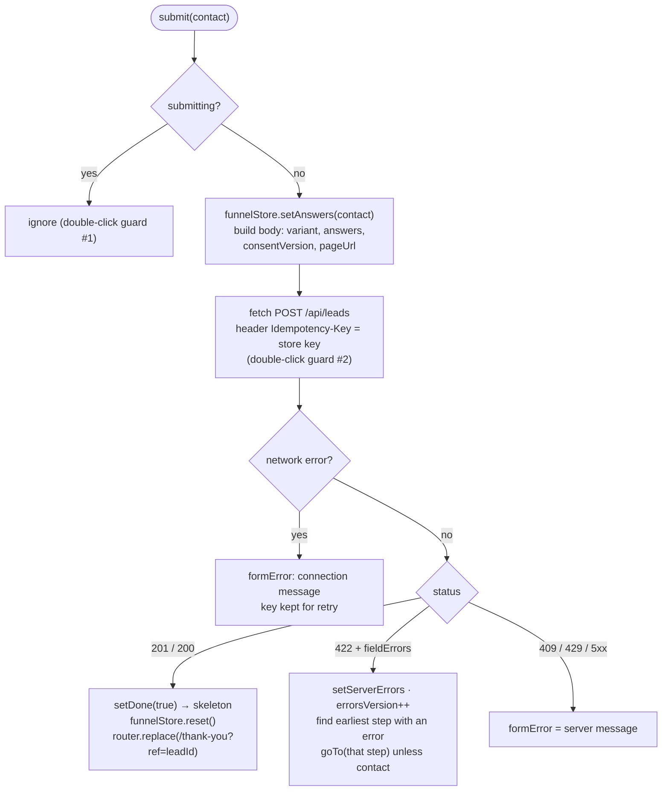

### 9d. Step components — [steps.tsx](../src/components/funnel/steps.tsx)

| Component | Input | Validation | Advances by |
|---|---|---|---|
| `ZipStep` | text input | `normalizeZip` on submit | `onAnswer({zip})` |
| `YearStep` | 8 recent-year buttons + an older-years `<select>` | buttons only offer valid years | click |
| `MakeStep` | popular-make buttons + other `<select>` | list only | click |
| `InsuredStep` | Yes / No buttons | n/a | click |
| `AgeStep` | age range buttons | list only | click |
| `ContactStep` | first, last, email, phone + consent text | `validate()` runs all four normalizers; focuses the first bad field | `onSubmit(values)` |

`ContactStep.bind(field)` wires each input: value, error, a "prefilled" hint, `onChange` (clears that error) and `onBlur` (saves the valid value to the store, so a refresh keeps it).

UI building blocks come from [ui.tsx](../src/components/ui.tsx): `SiteHeader`, `PrimaryButton`, `OptionButton`, `TextField`, `FieldError`, `PrefilledNote`.

### 9e. Landing → form — [LandingZip.tsx](../src/components/LandingZip.tsx)

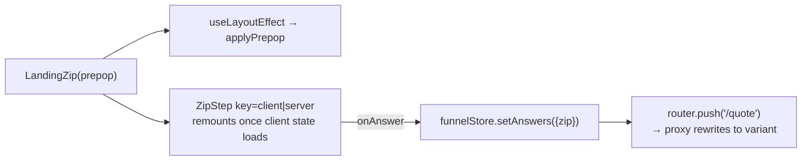

---

## 10. `POST /api/leads` — lead capture

### 10a. The route adapter — [route.ts](../src/app/api/leads/route.ts)

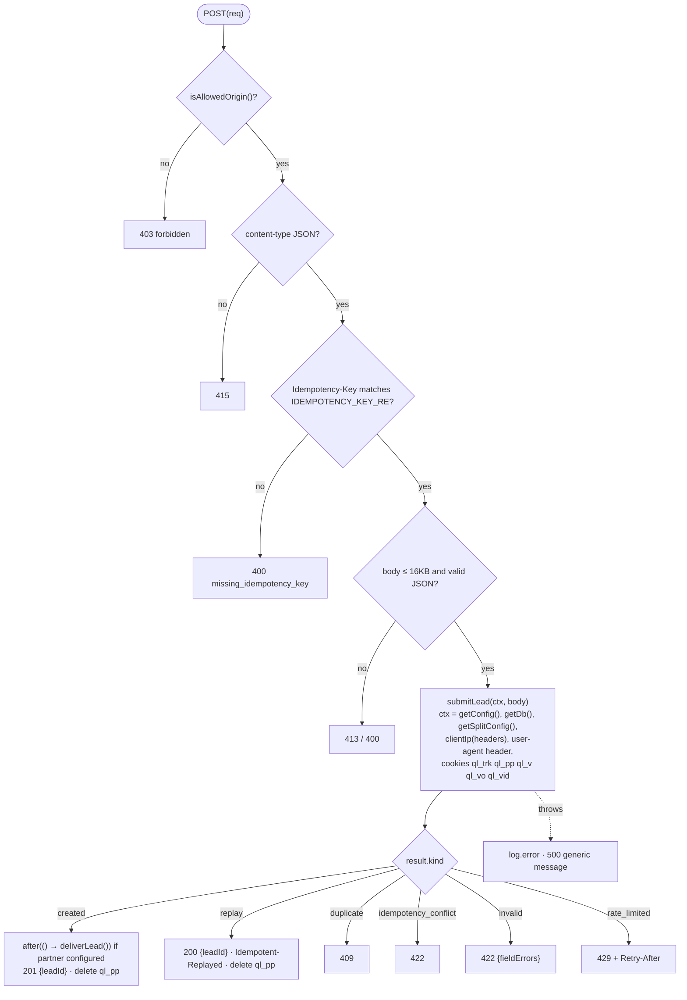

### 10b. The use case — `submitLead()` in [lead.service.ts](../src/server/leads/lead.service.ts)

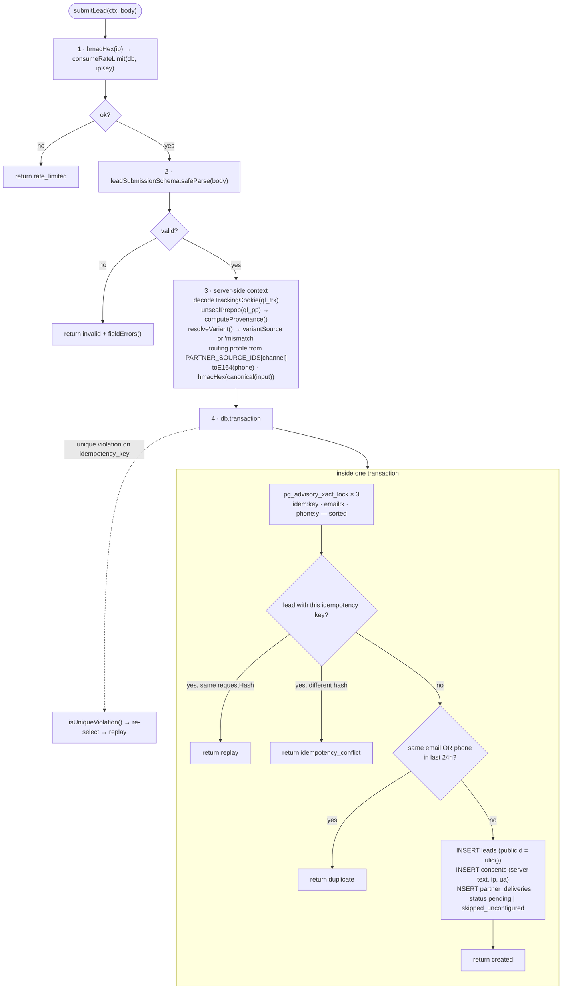

**`computeProvenance(input, prepop)`**: for each submitted field, if the sealed prefill had that field it records `{source: "prefill", modified: value changed?}`; otherwise `{source: "typed"}`.

---

## 11. Partner delivery (outbox)

**When:** started by `after()` right after the `201` is sent; also by the cron sweep.
**Files:** [outbox.ts](../src/server/delivery/outbox.ts) · [partner-client.ts](../src/server/delivery/partner-client.ts) · [payload.ts](../src/server/delivery/payload.ts)

### 11a. `deliverLead()` loop

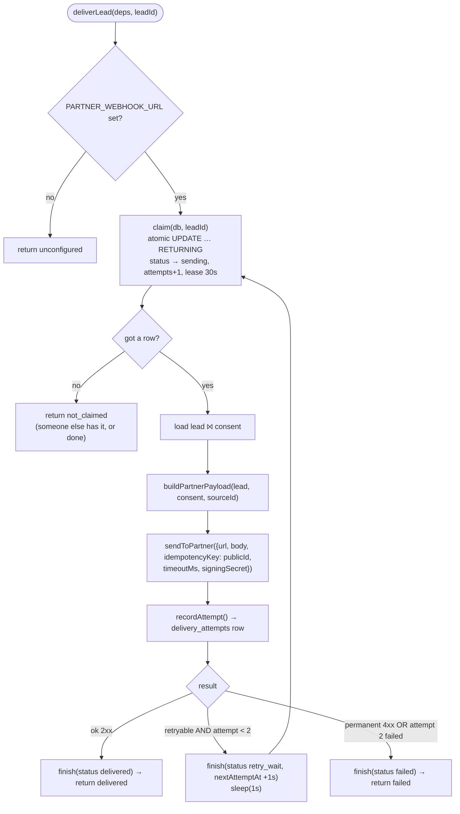

### 11b. The delivery state machine (`partner_deliveries.status`)

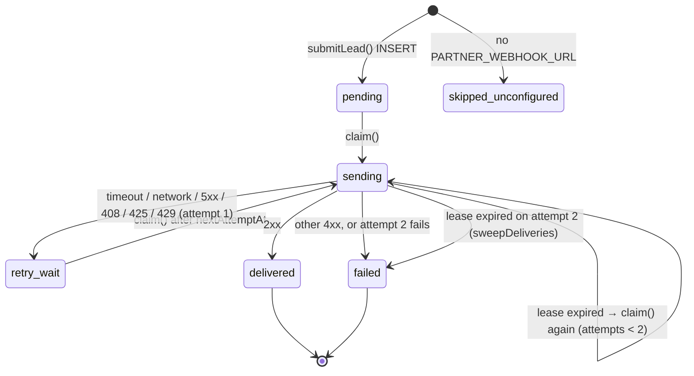

### 11c. One HTTP attempt — `sendToPartner()`

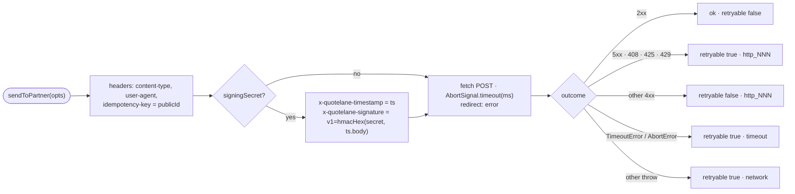

**`finish(db, leadId, attemptNo, set)`** only updates the row `WHERE status = 'sending' AND attempts = attemptNo`. A slow worker that lost its lease can't overwrite the newer worker's result.

### 11d. Payload shape — `buildPartnerPayload()`

```mermaid
flowchart LR
    LEAD["leads row"] --> PL
    CONS["consents row"] --> PL
    SRC["sourceId from PARTNER_SOURCE_IDS"] --> PL
    PL["payload v1"] --> F1["lead_id · created_at · brand · test"]
    PL --> F2["click_id (affiliate's) · aff_id<br/>sub_id (ours, ql_…) · source_id · channel · sub_ids"]
    PL --> F3["contact: first/last name, email, phone E.164, zip"]
    PL --> F4["vehicle · driver · variant"]
    PL --> F5["consent: version, text, consented_at, ip, user_agent, page_url"]
```

---

## 12. Cron + health routes

```mermaid
flowchart TD
    subgraph CRONR["GET /api/cron/deliveries — Vercel cron daily"]
        C1["safeEqual(Authorization, Bearer CRON_SECRET)?"] -->|no| C401["401"]
        C1 -->|yes| C2["sweepDeliveries({db, config})"]
        C2 --> C3["1 · mark failed: sending + lease expired + attempts ≥ 2"]
        C3 --> C4["2 · select due rows: pending/retry_wait due<br/>or sending with expired lease, attempts < 2"]
        C4 --> C5["3 · deliverLead() for each — same claim() guard"]
        C5 --> C6["purgeExpiredRateLimits(db)"]
        C6 --> C7["log.info · 200 {processed, exhausted, purged}"]
    end

    subgraph HEALTHR["GET /api/health"]
        H1["getSplitConfig()"] --> H2["getDb().execute(select 1)"]
        H2 -->|ok| H3["200 {db: up, splitPercentB, splitConfigValid}"]
        H2 -->|error| H4["503 {db: down}"]
    end
```

---

## 13. Shared server utilities

```mermaid
flowchart LR
    subgraph CFG["config.ts"]
        GC["getConfig()<br/>zod-parses env, memoized<br/>throws a clear error if invalid"]
        GSC["getSplitConfig()<br/>parseSplitPercent(SPLIT_PERCENT_B)"]
        GAS["getAppSecretOrNull()<br/>proxy-safe, never throws"]
        GBP["getBrandClickPrefix()"]
    end

    subgraph SEAL["crypto/seal.ts"]
        DK["deriveKey(secret, purpose)<br/>HKDF → AES-256-GCM key, cached"]
        SE["seal(data, secret, purpose, ttl)"]
        US["unseal(token, secret, purpose)<br/>null if tampered / expired"]
        HX["hmacHex(secret, msg)"]
        SE & US --> DK
    end

    subgraph HTTP["http.ts"]
        IP["clientIp(headers)<br/>x-real-ip / first x-forwarded-for, isIP()"]
        JS["json(body, status)<br/>adds Cache-Control: no-store"]
        AO["isAllowedOrigin(headers, url)"]
    end

    subgraph LOG["logger.ts"]
        LG["log.info / warn / error(event, fields)"] --> SC["scrub()<br/>allow-list keys · others → [redacted]<br/>errors cut to first line"]
    end

    subgraph DBM["db/client.ts"]
        CD["createDb(url)<br/>postgres.js pool, prepare:false"]
        GD["getDb()<br/>one pool per instance on globalThis"]
        GD --> CD
    end

    PPC["prepop-cookie.ts<br/>sealPrepop · unsealPrepop"] --> SE & US
    LS["lead.service"] --> HX
    PCL["partner-client"] --> HX
```

| Utility | Main callers |
|---|---|
| `getConfig` | `api/leads`, `api/cron` |
| `getSplitConfig` | `proxy` (via `decide`), `api/leads`, `api/health` |
| `getAppSecretOrNull` | `proxy`, `page-context` |
| `seal` / `unseal` | `prepop-cookie` only |
| `hmacHex` | `lead.service` (IP key, request hash), `partner-client` (signature) |
| `clientIp`, `isAllowedOrigin`, `json` | API routes |
| `log` | proxy, lead.service, outbox, API routes |

---

## 14. Cookie lifecycle

```mermaid
flowchart LR
    subgraph WRITERS["Written by"]
        PX["proxy()"]
        AV["applyVariantCookies()"]
        API["POST /api/leads"]
    end

    subgraph COOKIES["Cookies — all HttpOnly, SameSite=Lax"]
        VID["ql_vid · visitor id · 1y"]
        TRK["ql_trk · tracking · 30d"]
        PP["ql_pp · sealed prefill · 2h"]
        V["ql_v · sticky variant · 1y"]
        VO["ql_vo · forced variant · session"]
    end

    subgraph READERS["Read by"]
        PXR["proxy()"]
        PAGE["readPrepopForPage()"]
        SVC["submitLead()"]
    end

    PX --> VID & TRK & PP
    AV --> V & VO
    API -- "delete on success" --> PP

    VID --> PXR & SVC
    TRK --> PXR & SVC
    PP --> PAGE & SVC
    V --> PXR & SVC
    VO --> PXR & SVC
```

Browser JavaScript can't read any of these. The only browser-side storage is `sessionStorage` `ql_funnel_v1` (answers + idempotency key), cleared on submit.

---

## 15. Database tables and who touches them

```mermaid
flowchart LR
    subgraph FUNCS["Functions"]
        SL["submitLead()"]
        CRL["consumeRateLimit()"]
        PRL["purgeExpiredRateLimits()"]
        CLM["claim()"]
        FIN["finish()"]
        REC["recordAttempt()"]
        SWP["sweepDeliveries()"]
        DLV["deliverLead()"]
    end

    subgraph TABLES["Postgres — db/schema.ts"]
        L[("leads")]
        C[("consents")]
        PD[("partner_deliveries")]
        DA[("delivery_attempts")]
        RL[("rate_limits")]
    end

    SL -- "select idem/dupe · insert" --> L
    SL -- insert --> C
    SL -- insert --> PD
    CRL -- upsert --> RL
    PRL -- delete --> RL
    CLM -- "update … returning" --> PD
    FIN -- "fenced update" --> PD
    REC -- insert --> DA
    DLV -- "select lead ⨝ consent" --> L & C
    SWP -- "select due · mark exhausted" --> PD
```

Schema details and indexes: [docs/ARCHITECTURE.md §10](ARCHITECTURE.md#10-data-model). Migrations: [drizzle/](../drizzle).

---

## 16. Where do I find…?

| I want to change… | Go to |
|---|---|
| What counts as a valid ZIP / phone / email | [src/domain/fields.ts](../src/domain/fields.ts) |
| Which macros are ignored | [src/domain/sanitize.ts](../src/domain/sanitize.ts) → `MACRO_PATTERNS`, `NULLISH` |
| URL parameter names / aliases for prefill | [src/domain/prepop.ts](../src/domain/prepop.ts) → `PREPOP_PARAM_ALIASES` |
| Tracking params or channel aliases | [src/domain/tracking.ts](../src/domain/tracking.ts) |
| Split rules (kill switch, sticky, bots) | [src/domain/variant.ts](../src/domain/variant.ts) → `resolveVariant` |
| Which questions each version asks | [src/domain/steps.ts](../src/domain/steps.ts) → `STEPS` |
| Consent wording | [src/domain/consent.ts](../src/domain/consent.ts) (add a new version key; never edit an old one) |
| Error messages shown to visitors | [src/domain/lead-schema.ts](../src/domain/lead-schema.ts) → `MESSAGES` |
| Rate limits | [src/server/rate-limit.ts](../src/server/rate-limit.ts) → `LEAD_RATE_RULES` |
| Retry count / timeout / lease | [src/server/delivery/outbox.ts](../src/server/delivery/outbox.ts) → `MAX_ATTEMPTS`, `LEASE_SECONDS`, `RETRY_DELAY_MS`; env `PARTNER_TIMEOUT_MS` |
| What we send the partner | [src/server/delivery/payload.ts](../src/server/delivery/payload.ts) |
| Which log fields are allowed | [src/server/logger.ts](../src/server/logger.ts) → `SAFE_KEYS` |
| Security headers / CSP | [next.config.ts](../next.config.ts) |
| Cookie names and lifetimes | [src/domain/cookies.ts](../src/domain/cookies.ts) |
| Env vars | [src/server/config.ts](../src/server/config.ts) and [.env.example](../.env.example) |

### Tests that prove each module

| Module | Test file |
|---|---|
| sanitize, prepop | [tests/unit/prepop.test.ts](../tests/unit/prepop.test.ts) |
| fields, lead-schema | [tests/unit/fields.test.ts](../tests/unit/fields.test.ts) |
| variant | [tests/unit/variant.test.ts](../tests/unit/variant.test.ts) |
| tracking, steps, bots | [tests/unit/tracking-steps.test.ts](../tests/unit/tracking-steps.test.ts) |
| seal, logger | [tests/unit/security.test.ts](../tests/unit/security.test.ts) |
| submitLead (DB) | [tests/integration/leads.test.ts](../tests/integration/leads.test.ts) |
| outbox, sweep (DB + fake partner) | [tests/integration/delivery.test.ts](../tests/integration/delivery.test.ts) |
| Full browser journeys | [tests/e2e/funnel.spec.ts](../tests/e2e/funnel.spec.ts) |
